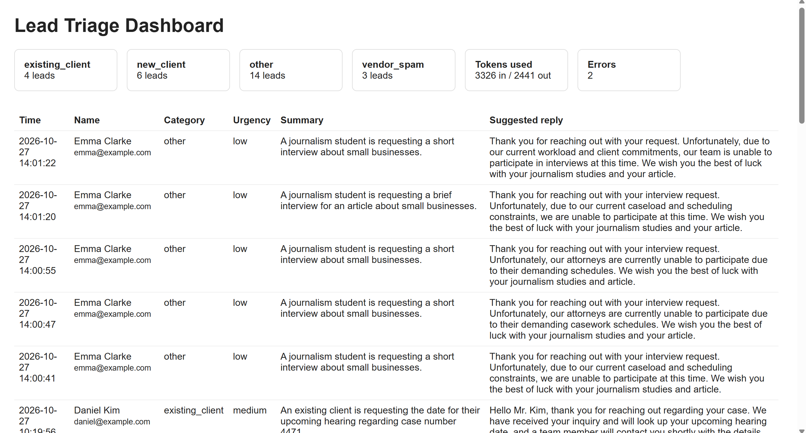

# Lead Triage Tool

A small web app that receives contact-form messages, uses an AI model to classify and summarize them, stores the results in a SQL database, and shows everything on a reporting dashboard.

Example scenario: a law firm's website contact form. Each message is sorted by category and urgency, summarized in one sentence, and given a draft reply for staff to review.

## Screenshots

**Dashboard**


**Contact form**


## How it works

```
Contact form / webhook  ->  Flask app  ->  Gemini API  ->  SQLite  ->  Dashboard
```

1. A message arrives from the contact form page (`/contact`) or from another program through the webhook (`POST /webhook/lead`).
2. The app sends it to the Gemini API with instructions to return JSON: category, urgency, summary and a suggested reply.
3. The result is saved in a SQLite table, together with token usage and any error.
4. The dashboard (`/`) shows leads, counts per category, total tokens used and the number of errors.

## Features

- Webhook endpoint protected with a shared secret (returns 401 without it, 400 for invalid input)
- Structured JSON output from the AI model
- Retry with increasing wait time when the API is busy or the connection drops
- Failures are saved with an error status instead of crashing the app
- Token usage tracking to monitor API cost
- Post/Redirect/Get on the contact form to prevent duplicate submissions

## Tech stack

Python, Flask, SQLite, Google Gemini API, HTML/CSS

## Run it locally

```bash
git clone https://github.com/astro-seta/lead-triage.git
cd lead-triage
python -m venv venv
venv\Scripts\activate          # Mac/Linux: source venv/bin/activate
pip install -r requirements.txt
```

Copy `.env.example` to `.env` and add your own Gemini API key, then:

```bash
python app.py
```

- Contact form: http://127.0.0.1:5000/contact
- Dashboard: http://127.0.0.1:5000

To test the webhook, run `python send_test.py` in a second terminal.

## Notes

- Only fake test data is used. Do not send real customer data to a free-tier API.
- The AI replies are drafts for staff to review, not sent automatically.
- This is a learning project and is not deployed.

## Possible improvements

- Email or Slack alert for high-urgency leads
- Daily summary report
- Cost estimate in dollars on the dashboard
- Deployment with a production database